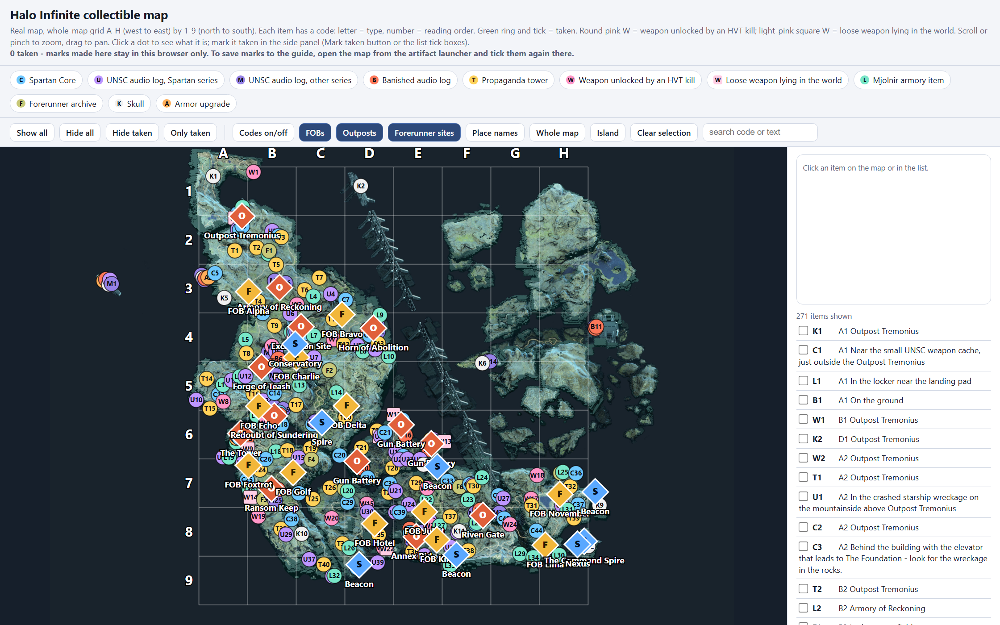

# Halo Infinite

A free hint guide for Halo Infinite's campaign, with spoiler levels you control. Get help with Zeta Halo's open world and missions. Your AI agent answers only from the guide files and tracks your place so you can pick back up.

## Use it

Install the [reader](https://github.com/hintforge/reader) in any AI agent that can read files on your computer, then tell it:

> Load the Halo Infinite guide from github.com/hintforge/halo-infinite

Try "where's the nearest Spartan Core", "what does this upgrade do" or "where was I".

The guide uses the [Hintforge](https://github.com/hintforge/builder) format. The agent reads and writes only files you control.

## Spoilers

Two independent dials control enemy warnings (Tier 0 to 5) and puzzle hints (Tier 0 to 3). Both start silent. Raise them for more help, up to full boss strategy or a step-by-step walkthrough.

The map leaves out High Value Targets so it won't reveal who you'll fight.

## What's inside

- Campaign mechanics, open-world navigation and every mission.
- Weapons, equipment, upgrades, named enemies and allies, and campaign puzzles.
- Collectibles by area with map codes, and achievements.

Multiplayer is out of scope.

## Collectible map

Open `artifacts/full_map.html` in any browser. It places 271 items on the game's map, coded by type on an A through H by 1 through 9 grid. Filter, search and tick off what you've found. Your ticks stay in that browser.
