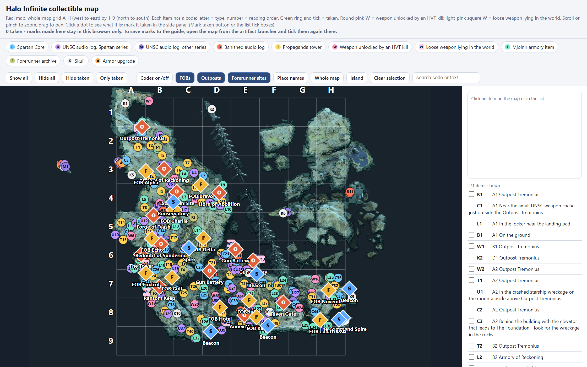

# Halo Infinite — Hintforge Companion

*The collectible map that ships in this repo (`artifacts/full_map.html`): 271 items on the game's own map, coded by type and placed on an A–H by 1–9 grid, with filters, search and tick boxes for what you've picked up. Open it in any browser; your ticks stay in that browser.*

A spoiler-controlled hint companion for **Halo Infinite**'s campaign on Zeta Halo. Built in the [Hintforge](https://github.com/hintforge/builder) format: a loyal sidekick that answers only from these guide files — never from guesswork — at the spoiler level you set, and that tracks where you are so you can step away and pick back up.

## Use it

You need a Hintforge reader running in Claude Code, Codex, or OpenClaw. Point it at this repo:

> Load the Halo Infinite guide from github.com/hintforge/halo-infinite

Then just ask — *"where's the nearest Spartan Core," "what does this upgrade do," "where was I."* Runtime setup lives in [`hintforge/reader`](https://github.com/hintforge/reader).

## Spoilers

**You** control how much this guide volunteers, through two independent dials you set:

- **Enemy warnings (Tier 0–5)** — from "say nothing" up to full boss strategy.
- **Puzzle warnings (Tier 0–3)** — from "silent, ask when you want a hint" up to a step-by-step walkthrough.

Both start **silent** — the guide volunteers nothing pre-emptively until you raise a dial (*"set enemy warning to tier 3"*). The guide only honors what you set. The map leaves High Value Targets off, so it won't show you who you'll be fighting.

## What's inside

A structured Markdown corpus for the campaign — mechanics, zone navigation for the open world and every mission, weapons, equipment and upgrades, named enemies and allies, the few puzzles the campaign has, collectibles by area with their map codes, and the achievements. Multiplayer is out of scope. The companion reads and writes only the files you control.
